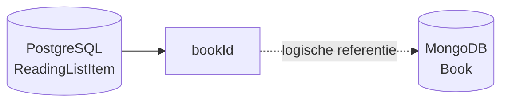
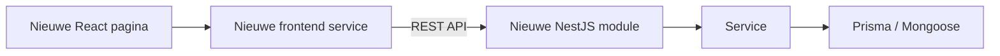

# Architectuur - Vrij lezen op maat

## Doel van dit document

Dit document beschrijft de belangrijkste **architectuurkeuzes, grenzen en trade-offs** binnen de Proof of Concept **Vrij lezen op maat**. De technische structuur van de afzonderlijke lagen wordt niet opnieuw volledig beschreven. Daarvoor wordt verwezen naar:

- [Root README](../README.md) voor het algemene systeemoverzicht;
- [Frontend README](../frontend/README.md) voor de React-architectuur;
- [Backend README](../backend/README.md) voor de NestJS-architectuur;
- [ERD](./ERD.md) voor het datamodel.

Dit document richt zich vooral op de keuzes achter de architectuur en op de manier waarop de verschillende delen van het systeem van elkaar gescheiden blijven.

---

## Architectuurstijl

De applicatie gebruikt een **gelaagde en modulaire architectuur** met een duidelijke scheiding tussen:

1. de gebruikersinterface;
2. de backend en businesslogica;
3. de persistence-laag.

Op hoofdlijnen verloopt communicatie als volgt:

```text
React frontend
    ↓ REST / HTTP / JSON + JWT
NestJS backend
    ↓
Prisma / Mongoose
    ↓
PostgreSQL / MongoDB
```

De frontend heeft geen directe toegang tot de databases.

Alle gegevens worden via de REST API van de NestJS-backend opgehaald of gewijzigd.

---

## Verantwoordelijkheden per laag

### Frontend

De frontend is verantwoordelijk voor:

- gebruikersinteractie;
- presentatie van gegevens;
- navigatie;
- lokale en gedeelde UI-state;
- communicatie met de REST API.

Businessregels en toegangscontrole worden niet uitsluitend in de frontend afgedwongen.

De verdere frontendstructuur staat beschreven in de [Frontend README](../frontend/README.md).

### Backend

De backend is verantwoordelijk voor:

- businesslogica;
- authenticatie;
- autorisatie;
- requestvalidatie;
- aanbevelingslogica;
- databasecommunicatie;
- het aanbieden van de REST API.

De verdere structuur van controllers, services, DTO's en modules staat beschreven in de [Backend README](../backend/README.md).

### Datalaag

De applicatie gebruikt zowel PostgreSQL als MongoDB.

De databases hebben ieder een duidelijk eigen verantwoordelijkheidsgebied.

---

# Verdeling van data

## PostgreSQL

PostgreSQL bevat relationele applicatiegegevens zoals:

- gebruikers;
- leesprofielen;
- profielantwoorden;
- voorkeuren;
- leeslijstitems;
- docent-studentkoppelingen.

Deze gegevens hebben onderlinge relaties en profiteren daarom van een relationeel datamodel.

Prisma wordt gebruikt voor toegang tot PostgreSQL en voor het beheren van schemawijzigingen via migraties.

---

## MongoDB

MongoDB bevat de boekcatalogus.

De catalogus bestaat uit documenten met onder andere:

- titel;
- auteur;
- beschrijving;
- leesniveau;
- thema's;
- lengte;
- materiaaltype.

De documentstructuur sluit aan op de vorm waarin de catalogusdata binnen deze Proof of Concept wordt gebruikt.

Mongoose verzorgt de toegang vanuit NestJS.

---

## Relatie tussen PostgreSQL en MongoDB

Dezelfde boekgegevens worden niet volledig in beide databases opgeslagen.

Een leeslijstitem in PostgreSQL bevat een `bookId` dat verwijst naar het bijbehorende boek in MongoDB.



Omdat het twee verschillende databases zijn bestaat hiervoor geen echte database foreign key.

De applicatielaag is verantwoordelijk voor het correct gebruiken van deze referentie.

---

# Architectuurkeuzes en trade-offs

## React als aparte frontend

De React-applicatie is als aparte frontend gebouwd en communiceert via een REST API met de backend.

### Voordelen

- frontend en backend hebben een duidelijke eigen verantwoordelijkheid;
- UI-componenten kunnen hergebruikt worden;
- de frontend kan onafhankelijk van database-implementaties werken;
- de backend kan ook door andere clients worden aangeroepen.

### Trade-off

Door de scheiding is extra API-communicatie en mapping tussen frontend- en backenddata nodig.

Voor deze applicatie is deze complexiteit acceptabel omdat de scheiding de verantwoordelijkheden duidelijker maakt.

---

## NestJS voor de backend

NestJS ondersteunt van zichzelf een modulaire structuur met controllers, services, modules, guards en dependency injection.

Dit sluit goed aan op de gewenste scheiding van verantwoordelijkheden.

### Voordelen

- duidelijke modulaire structuur;
- dependency injection;
- ondersteuning voor guards en decorators;
- goede integratie met OpenAPI/Swagger;
- TypeScript wordt door de volledige backend gebruikt.

### Trade-off

NestJS introduceert meer structuur en configuratie dan een kleinere Node.js-library.

Voor dit project is die extra structuur juist nuttig omdat de backend meerdere functionele modules bevat.

---

## PostgreSQL voor relationele gegevens

PostgreSQL wordt gebruikt voor gegevens waarbij relaties en constraints belangrijk zijn.

### Voordelen

- sterke relationele structuur;
- constraints en unieke relaties;
- transacties;
- geschikt voor gebruikers-, profiel- en koppelingsdata.

### Trade-off

Schemawijzigingen moeten gecontroleerd worden uitgevoerd en vereisen migraties.

Voor de relationele gegevens binnen deze applicatie is deze structuur gewenst.

---

## MongoDB voor de boekcatalogus

MongoDB wordt gebruikt voor de catalogusdata.

### Voordelen

- sluit goed aan op documentgebaseerde boekdata;
- arrays zoals thema's en niveaus kunnen eenvoudig binnen een document worden opgeslagen;
- flexibel bij catalogusdata met verschillende eigenschappen.

### Trade-off

Door MongoDB naast PostgreSQL te gebruiken zijn er twee persistence-technologieën die beheerd moeten worden.

Daarnaast kan geen database foreign key worden gebruikt tussen een leeslijstitem en een MongoDB-boek.

Deze extra complexiteit is binnen deze Proof of Concept geaccepteerd vanwege de gekozen scheiding tussen catalogusdata en relationele gebruikersdata.

---

# Prisma en Mongoose

Voor PostgreSQL wordt **Prisma** gebruikt.

Voor MongoDB wordt **Mongoose** gebruikt.

Hierdoor hoeft de applicatie niet rechtstreeks databasequeries op laag niveau uit te voeren.
De keuze brengt wel mee dat de backend gekoppeld is aan deze persistence-libraries.

---

# Geen repositorylaag

Binnen de huidige backend gebruiken services Prisma en Mongoose rechtstreeks.

Er is geen extra repositorylaag tussen de services en de persistence-technologie toegevoegd.

```text
Service
   ↓
Prisma / Mongoose
   ↓
Database
```

### Waarom?

Voor de omvang van deze Proof of Concept zou een extra repositorylaag voornamelijk extra bestanden, interfaces en boilerplate toevoegen. De huidige structuur blijft daardoor eenvoudiger.

### Trade-off

Services zijn hierdoor direct gekoppeld aan Prisma of Mongoose. Bij een grotere productieapplicatie kan een repository- of data-accesslaag nuttig worden wanneer:

- database-implementaties verwisselbaar moeten zijn;
- domeinlogica volledig los moet staan van de ORM;
- meerdere databronnen achter dezelfde interface gebruikt moeten worden.

Voor de huidige scope is deze koppeling geaccepteerd.

---

# API-contract

Frontend en backend communiceren via een REST API.

De backend publiceert hiervoor een OpenAPI-specificatie via Swagger.

De frontendservices zijn handmatig afgestemd op deze API.

De OpenAPI-specificatie beschrijft onder andere:

- endpoints;
- HTTP-methodes;
- requeststructuren;
- authenticatie;
- responsevormen.

De clientcode wordt binnen deze Proof of Concept niet automatisch vanuit OpenAPI gegenereerd.

Dit betekent dat wijzigingen in de API handmatig consistent moeten worden doorgevoerd in zowel backend als frontend.

De actuele Swagger-documentatie is tijdens development beschikbaar via:

```text
http://localhost:3000/api-docs
```

---

# Security als architectuuronderdeel

Authenticatie en autorisatie worden centraal in de backend afgedwongen.

De frontend gebruikt routebescherming voor de gebruikerservaring, maar dit is niet de beveiligingsgrens van het systeem.

De backend controleert onder andere:

- of een JWT aanwezig en geldig is;
- welke rol bij de gebruiker hoort;
- of een docent aan de betreffende student gekoppeld is.

Hierdoor blijft beveiliging onderdeel van de server-side architectuur.

De rollen binnen het systeem zijn:

```text
STUDENT
TEACHER
```

Bij docentfunctionaliteit wordt naast rolcontrole ook **objectautorisatie** toegepast.

Een docent kan daardoor niet alleen op basis van een aangepast student-ID gegevens van een willekeurige student opvragen.

---

# Transacties en data-integriteit

Bij bewerkingen waarbij meerdere relationele records samen gewijzigd worden kan Prisma een database-transactie gebruiken. Dit is onder andere relevant bij het opslaan van een leesprofiel met meerdere gekoppelde gegevens. Het doel hiervan is dat een wijziging als één geheel wordt verwerkt. Wanneer een onderdeel van de bewerking mislukt, hoort niet slechts een deel van het nieuwe profiel opgeslagen te blijven.

---

# Uitbreidbaarheid

Een niet-functioneel uitgangspunt van het project is dat een nieuwe feature van vergelijkbare omvang binnen de bestaande structuur moet passen zonder de architectuur te doorbreken.

De huidige structuur ondersteunt dit doordat frontend- en backendfunctionaliteit per verantwoordelijkheid gescheiden zijn.

Stel dat later functionaliteit voor **favoriete boeken** wordt toegevoegd.

De bestaande lagen kunnen dan behouden blijven:



Er hoeft hiervoor bijvoorbeeld geen:

- businesslogica naar React verplaatst te worden;
- database direct vanuit de frontend benaderd te worden;
- bestaande module volledig herschreven te worden;
- nieuwe architectuurlaag geïntroduceerd te worden.

De nieuwe functionaliteit kan dus binnen dezelfde architectuurprincipes worden toegevoegd.

---

# Bewuste beperkingen van de Proof of Concept

De architectuur is ontworpen voor de scope van deze Proof of Concept. Daarom zijn enkele keuzes bewust eenvoudiger gehouden dan mogelijk in een productieomgeving.

Onder andere:

- er is geen aparte repositorylaag;
- de OpenAPI-client wordt niet automatisch gegenereerd;
- PostgreSQL en MongoDB zijn logisch gekoppeld via applicatiecode;
- alleen lokale deployment is ingericht en getest;
- gebruikersregistratie valt buiten de scope.

Deze keuzes houden de implementatie beheersbaar zonder de belangrijkste architectuurlagen te doorbreken.

---

# Gerelateerde documentatie

- [Project README](../README.md)
- [Frontend README](../frontend/README.md)
- [Backend README](../backend/README.md)
- [ERD](./ERD.md)
- [Teststrategie](./test-strategy.md)