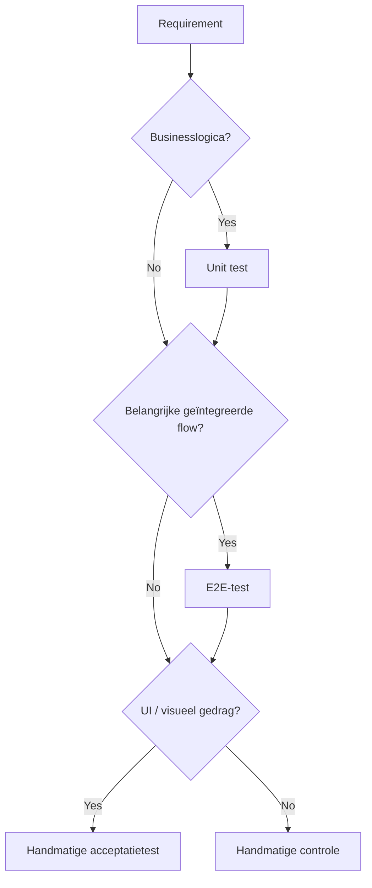
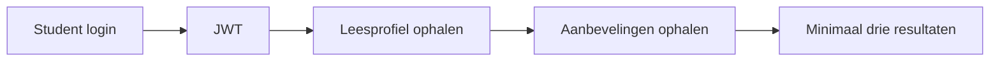
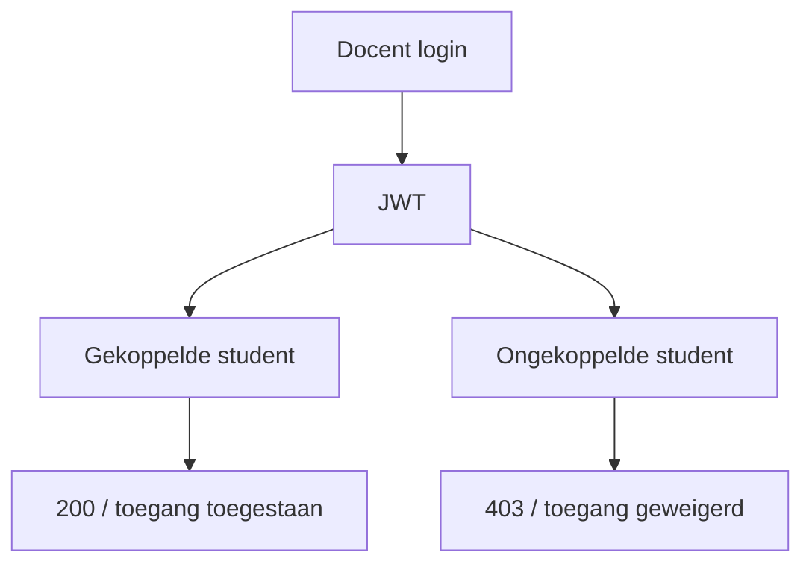

# Teststrategie - Vrij lezen op maat

## Doel

Dit document beschrijft de teststrategie van de Proof of Concept **Vrij lezen op maat**.

Het doel van de teststrategie is niet om iedere methode of ieder endpoint afzonderlijk te testen. Er is gekozen voor een risico- en belanggerichte aanpak waarbij vooral de belangrijkste businesslogica, foutgevallen, gebruikersflows en beveiligingsrisico's worden gecontroleerd.

---

# Teststrategie

| Testniveau | Doel | Toepassing |
|---|---|---|
| Unit tests | Businesslogica geïsoleerd controleren | Matching, leesprofiel, leeslijst en docentkoppelingen |
| E2E-tests | Controleren of meerdere lagen daadwerkelijk samenwerken | Belangrijkste studentflow en docentautorisatie |
| Handmatige acceptatietests | Gebruikersgedrag, navigatie en visuele eisen controleren | FR1 t/m FR6 waar UI-interactie belangrijk is |
| Handmatige quality checks | Niet-functionele kwaliteit controleren | Responsive design, accessibility en architectuur |
| Linting | Statische codekwaliteit controleren | Frontend en backend |

---

# Uitgangspunt

Niet alle functionaliteit heeft hetzelfde risico.

Daarom zijn verschillende testvormen gebruikt.



Hierdoor wordt de belangrijkste functionaliteit gecontroleerd zonder een onnodig grote hoeveelheid tests voor deze Proof of Concept te maken.

---

# Unit tests

Unit tests worden gebruikt voor businesslogica die goed geïsoleerd getest kan worden.

De backendunit tests worden uitgevoerd met **Jest**.

```bash
npm test
```

---

## FR1 - Leesprofiel invullen

### Geldig leesprofiel

**Doel**

Controleren dat een volledig en geldig leesprofiel kan worden opgeslagen.

**Verwacht resultaat**

De service verwerkt onder andere:

- taalniveau;
- voorkeurslengte;
- leesdoel;
- genres;
- thema's;
- antwoorden.

correct.

---

## FR2 - Leesprofiel inzien en wijzigen

### Geen bestaand leesprofiel

**Doel**

Controleren wat er gebeurt wanneer een student nog geen opgeslagen profiel heeft.

**Verwacht resultaat**

De service retourneert een `NotFoundException`.

Het opslaan en wijzigen van een profiel loopt via dezelfde save/update-logica van de leesprofielservice.

---

# FR3 - Leesadvies ontvangen

De aanbevelingslogica bevat relatief veel businessregels en heeft daarom meerdere unit tests.

## Matchingcriteria

Boeken worden gescoord op basis van meerdere eigenschappen, waaronder:

- leesniveau;
- thema;
- lengte;
- materiaaltype.

## Scoreberekening

De ingestelde gewichten worden gecontroleerd zodat een passend boek de verwachte score krijgt.

## Lengtevoorkeur

Er wordt gecontroleerd dat een boek met een passende lengte de ingestelde lengtescore ontvangt.

## Gecombineerde niveaus

Catalogusniveaus die meerdere niveaus bevatten, bijvoorbeeld `2F-3F`, moeten correct kunnen matchen met het leesprofiel.

## Fallback

Wanneer onvoldoende boeken voldoende matchen wordt gecontroleerd dat de service alsnog minimaal drie aanbevelingen kan teruggeven.

Fallback-resultaten worden daarbij herkenbaar als fallback behandeld.

## Geen leesprofiel

Wanneer een student nog geen leesprofiel heeft kan geen persoonlijk advies worden berekend.

**Verwacht resultaat**

De service retourneert een `NotFoundException`.

---

# FR4 - Catalogus inzien

De catalogus bevat onder andere:

- pagination;
- filters;
- gecombineerde filters;
- resetmogelijkheden.

Voor deze Proof of Concept is ervoor gekozen deze functionaliteit voornamelijk handmatig te controleren in plaats van hiervoor een uitgebreide afzonderlijke unit-testset te schrijven.

De reden hiervoor is dat de kernlogica met een hoger risico, zoals aanbevelingen en autorisatie, prioriteit heeft gekregen.

Tijdens handmatige acceptatie wordt gecontroleerd dat:

- boeken zichtbaar zijn;
- paginering werkt;
- filters werken;
- filters gecombineerd kunnen worden;
- filters gereset kunnen worden.

---

# FR5 - Leeslijst bijhouden

De leeslijst bevat businessregels die met unit tests worden gecontroleerd.

## Boek toevoegen

**Doel**

Controleren dat een bestaand catalogusboek aan de leeslijst kan worden toegevoegd.

**Verwacht resultaat**

Het leeslijstitem wordt gekoppeld aan de juiste student.

## Dubbel boek toevoegen

**Doel**

Voorkomen dat hetzelfde boek meerdere keren aan dezelfde leeslijst wordt toegevoegd.

**Verwacht resultaat**

De service retourneert een `ConflictException`.

## Gelezenstatus wijzigen

**Doel**

Controleren dat de gelezenstatus kan worden gewijzigd.

**Verwacht resultaat**

`isRead` wordt correct aangepast.

## Niet-bestaand leeslijstitem

**Doel**

Controleren dat een niet-bestaand item niet gewijzigd kan worden.

**Verwacht resultaat**

De service retourneert een `NotFoundException`.

---

# FR6 - Docent-studentkoppelingen

Deze functionaliteit heeft naast functioneel belang ook een beveiligingsrisico.

Daarom worden zowel functionele als autorisatiegevallen getest.

## Student koppelen aan docent

**Doel**

Controleren dat een student zichzelf aan een bestaande docent kan koppelen.

**Verwacht resultaat**

Er wordt een geldige docent-studentkoppeling aangemaakt.

## Alleen gekoppelde studenten ophalen

**Doel**

Controleren dat een docent alleen de eigen gekoppelde studenten terugkrijgt.

**Verwacht resultaat**

Alleen studenten met een geldige koppeling worden geretourneerd.

## Ongekoppelde student

**Doel**

Voorkomen dat een docent gegevens van een willekeurige student kan bekijken.

**Verwacht resultaat**

De service retourneert een `ForbiddenException`.

## Boek toevoegen als docent

**Doel**

Controleren dat een gekoppelde docent een catalogusboek aan de leeslijst van een student kan toevoegen.

**Verwacht resultaat**

Het boek wordt toegevoegd aan de leeslijst van de gekoppelde student.

---

# E2E-tests

E2E-tests controleren of meerdere onderdelen van de applicatie daadwerkelijk samenwerken.

De tests worden uitgevoerd met:

```bash
npm run test:e2e
```

Er is bewust gekozen voor twee representatieve en risicovolle flows in plaats van ieder endpoint afzonderlijk end-to-end te testen.

---

## E2E-01 - Studentflow

**Requirements**

- FR2
- FR3
- NFR6

**Flow**



### Acceptatiecriteria

- student kan succesvol inloggen;
- login levert een JWT op;
- met de JWT kan het eigen leesprofiel worden opgehaald;
- persoonlijke aanbevelingen kunnen worden opgehaald;
- minimaal drie aanbevelingen worden geretourneerd.

### Waarom deze flow?

Deze flow vertegenwoordigt een belangrijk deel van de kernfunctionaliteit van de applicatie.

Daarnaast controleert de test meerdere lagen tegelijk:

- authenticatie;
- REST API;
- leesprofiel;
- aanbevelingsservice;
- databasecommunicatie.

---

# E2E-02 - Docentautorisatie

**Requirements**

- FR6
- NFR6

**Flow**



### Acceptatiecriteria

- docent kan succesvol inloggen;
- gekoppelde student is toegankelijk;
- ongekoppelde student is niet toegankelijk.

### Waarom deze flow?

Dit is een belangrijke beveiligingsflow.

Zonder objectautorisatie zou een docent mogelijk door het wijzigen van een student-ID gegevens van andere studenten kunnen bekijken.

Daarom is bewust gekozen om zowel de positieve als negatieve autorisatiesituatie end-to-end te controleren.

---

# Handmatige acceptatietests

Niet alle eisen zijn efficiënt via unit tests te controleren.

UI-gedrag en visuele interactie worden daarom ook handmatig gecontroleerd.

Voor FR1 t/m FR6 wordt onder andere gekeken naar:

- correcte navigatie;
- formuliergedrag;
- foutmeldingen;
- laden van gegevens;
- gebruikersfeedback;
- filtering;
- pagina-overgangen;
- student- en docentfunctionaliteit.

---

# Responsive design

Responsive gedrag wordt handmatig gecontroleerd op desktop- en mobiele schermformaten.

Hierbij wordt onder andere gecontroleerd dat:

- content leesbaar blijft;
- navigatie bruikbaar blijft;
- de mobiele navigatie werkt;
- gebruikersnaam en uitlogfunctionaliteit beschikbaar blijven;
- formulieren bruikbaar blijven;
- belangrijke functionaliteit niet verdwijnt.

---

# Accessibility

Accessibility wordt handmatig gecontroleerd aan de hand van relevante punten uit WCAG 2.1 niveau A.

Onder andere wordt gekeken naar:

- toetsenbordnavigatie;
- zichtbare focus;
- semantische HTML;
- labels bij inputs;
- kleurcontrast;
- foutmeldingen;
- relevante ARIA-attributen.

---

# API- en securitychecks

Naast de geautomatiseerde tests worden beveiligde API-endpoints waar nodig handmatig gecontroleerd.

Daarbij kunnen onder andere de volgende situaties worden gecontroleerd:

```text
Geldige login
    → JWT

Geen JWT
    → toegang geweigerd

Ongeldige JWT
    → toegang geweigerd

Student op docentendpoint
    → toegang geweigerd

Gekoppelde docent
    → student toegankelijk

Ongekoppelde docent
    → toegang geweigerd
```

Deze controles ondersteunen het bewijs dat authenticatie, rollen en objectautorisatie niet alleen in de frontend worden afgedwongen.

---

# Linting

Linting is onderdeel van de kwaliteitscontrole.

## Backend

De backend gebruikt Oxlint:

```bash
npm run lint
```

## Frontend

De frontend gebruikt ESLint:

```bash
npm run lint
```

Linting controleert statisch op mogelijke codeproblemen en overtredingen van ingestelde codeconventies.

Voor de definitieve versie van de Proof of Concept worden frontend en backend zonder lintfouten uitgevoerd.

---

# Waarom niet alles geautomatiseerd?

Binnen deze Proof of Concept is bewust gekozen voor een beperkte maar doelgerichte testset.

Volledige testdekking zou relatief veel ontwikkeltijd kosten terwijl niet ieder onderdeel hetzelfde risico heeft.

De hoogste prioriteit ligt daarom bij:

1. kernbusinesslogica;
2. fout- en randgevallen;
3. aanbevelingslogica;
4. leeslijstregels;
5. docentautorisatie;
6. belangrijkste geïntegreerde gebruikersflows.

Visuele en interactieve eisen worden waar mogelijk handmatig gecontroleerd.

Deze strategie levert met een relatief beperkt aantal tests veel zekerheid over de onderdelen met het hoogste functionele of beveiligingsrisico.

---

# Samenvatting

De teststrategie combineert:

```text
Unit tests
    +
E2E-tests
    +
Handmatige acceptatietests
    +
Responsive/accessibility checks
    +
API/security checks
    +
Linting
```

Hiermee worden zowel functionele eisen als belangrijke niet-functionele risico's gecontroleerd.

---

# Gerelateerde documentatie

- [Root README](../README.md)
- [Frontend README](../frontend/README.md)
- [Backend README](../backend/README.md)
- [Architectuur](./architecture.md)
- [ERD](./ERD.md)