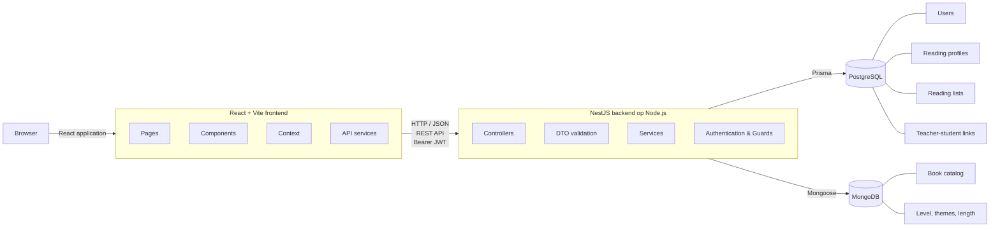
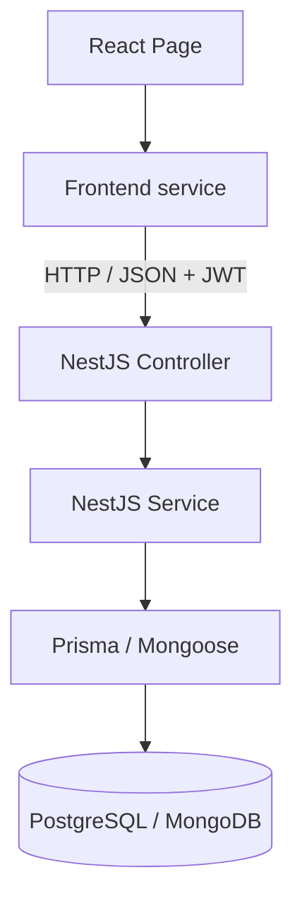

# Proof of Concept 'Vrij lezen op maat'

Dit project is een **Proof of Concept** dat bedoeld is voor MBO en NT2-studenten om hen te helpen om meer te gaan lezen.
Het hoofddoel daarbij is om ze meer te motiveren om te gaan lezen, waarbij deze applicatie kan bijdragen
door ze passende boeken te geven op basis van hun leesprofiel. Het leesprofiel wordt samengesteld op basis van een aantal vragen die door de student worden ingevuld. Daarnaast hebben zij de mogelijkheid om de catalogus te bekijken, een eigen leeslijst bij te houden en zichzelf te koppelen aan een docent. De docent kan dan van de gekoppelde studenten zien wat hun leesprofiel is en welke boeken op hun leeslijst staan. Ook heeft de docent de mogelijkheid om boeken aan de leeslijst van de gekoppelde studenten toe te voegen. De studenten zelf kunnen per boek aangeven of ze deze wel of niet gelezen hebben.

## Functional requirements

Het project is opgebouwd aan de hand van een zestal functional requirements:
- FR1: Leesprofiel invullen
- FR2: Leesprofiel inzien en wijzigen
- FR3: Leesadvies ontvangen
- FR4: Catalogus inzien
- FR5: Leeslijst bijhouden
- FR6: Inzage in leeslijst door docenten

## Tech Stack

| Laag | Technologie |
|------|-------------|
| Frontend | React, TypeScript, Vite |
| Backend | NestJS, TypeScript, Node.js |
| Relationele database | PostgreSQL |
| Documentdatabase | MongoDB |
| ODM | Mongoose |
| ORM | Prisma |
| Authenticatie | JWT + bcrypt |
| API | REST / JSON |
| API-documentatie | OpenAPI / Swagger |
| Backend tests | Jest |
| Frontend tests | Vitest |
| Backend linting | Oxlint |
| Frontend linting | ESLint |

## Systeemarchitectuur



## API-documentatie

De API docs zijn te vinden op [http://localhost:3000/api-docs](http://localhost:3000/api-docs)



## Projectstructuur

De applicatie is opgesplitst in een aparte frontend en backend. De frontend bevat de gebruikersinterface en communicatie met de API. De backend bevat authenticatie, businesslogica en toegang tot **PostgreSQL* en **MongoDB*.

```text
VrijLezenOpMaat/
├── frontend/
│   ├── src/
│   │   ├── components/
│   │   ├── config/
│   │   ├── context/
│   │   ├── layouts/
│   │   ├── pages/
│   │   ├── routes/
│   │   ├── services/
│   │   ├── test/
│   │   └── types/
│   └── README.md
│
├── backend/
│   ├── src/
│   │   ├── auth/
│   │   ├── books/
│   │   ├── generated/
│   │   ├── prisma/
│   │   ├── reading-list/
│   │   ├── reading-profile/
│   │   ├── recommendations/
│   │   └── teacher-student-links/
│   ├── prisma/
│   ├── test/
│   └── README.md
│
└── README.md
```

### Frontend

- `components/` bevat herbruikbare UI-componenten, zoals knoppen, boekkaarten en dashboardcomponenten.
- `config/` bevat centrale frontendconfiguratie en vaste configuratiewaarden die door meerdere onderdelen worden gebruikt.
- `context/` bevat gedeelde applicatiestatus, waaronder de authenticatiestatus van de ingelogde gebruiker.
- `layouts/` bevat gedeelde pagina-indelingen, zoals de algemene structuur met header en navigatie.
- `pages/` bevat de pagina-componenten die gekoppeld zijn aan routes in de applicatie.
- `routes/` bevat de routerconfiguratie en routebescherming voor de verschillende pagina's.
- `services/` bevat de functies die HTTP-verzoeken naar de NestJS-backend uitvoeren.
- `test/` bevat de configuratie en ondersteuning voor frontendtests.
- `types/` bevat gedeelde TypeScript-types en interfaces voor frontenddata.

### Backend

- `auth/` bevat login, JWT-validatie, authenticatieguards en bijbehorende authenticatielogica.
- `books/` bevat toegang tot de MongoDB-catalogus, filtering, paginering en normalisatie van boekdata.
- `generated/` bevat automatisch gegenereerde code van Prisma die door gebruikte tooling wordt aangemaakt en niet handmatig wordt onderhouden.
- `prisma/` binnen `src/` bevat de Prisma-service en configuratie voor toegang tot PostgreSQL database.
- `reading-list/` bevat de logica voor het beheren van persoonlijke leeslijsten en de status van boeken (wel/niet gelezen).
- `reading-profile/` bevat de logica voor het opslaan, ophalen en wijzigen van leesprofielen.
- `recommendations/` bevat de matching- en scorelogica waarmee persoonlijke leesadviezen worden samengesteld.
- `teacher-student-links/` bevat de koppeling tussen studenten en docenten en de autorisatie voor docentinzage.

- `prisma/` op rootniveau van de backend bevat het Prisma-schema en de database-migraties.
- `test/` bevat de end-to-end tests van de backend.

De frontend en backend hebben daarnaast ieder een eigen `README.md` met specifieke installatie-, start-, test- en configuratie-instructies.

## Lokaal starten

### Vereisten

Voor het lokaal draaien van het project zijn minimaal de volgende programma's nodig:

- Node.js
- npm
- Docker Desktop
- Git

### Repository ophalen

```bash
git clone <repository-url>
cd Project VrijLezenOpMaat
```

### Project opstarten

Start de benodigde Docker-containers:
```bash
docker compose up -d
```

Controleer de containers:
``` bash
docker compose ps
```

### Backend

Ga naar de backend map:
```bash
cd backend
```

Installeer de dependencies:
```bash
npm install
```

### Environment variables

Maak in backend/ een .env-bestand aan op basis van de benodigde variabelen. .env-bestanden worden niet gecommit.
Voor de E2E-tests wordt backend/.env.test gebruikt.

`.env:`
PostgreSQL:
- DATABASE_URL
- JWT_SECRET

- POSTGRES_USER
- POSTGRES_PASSWORD
- POSTGRES_DB

MongoDB:
- MONGODB_URI
- MONGODB_USERNAME
- MONGODB_PASSWORD

Voor de testaccounts is er hier de mogelijkheid om de wachtwoorden neer te zetten:
- SEED_STUDENT_PASSWORD
- SEED_TEACHER_PASSWORD

`.env.test`
- E2E_STUDENT_EMAIL
- E2E_STUDENT_PASSWORD

- E2E_TEACHER_EMAIL
- E2E_TEACHER_PASSWORD

- E2E_LINKED_STUDENT_ID
- E2E_UNLINKED_STUDENT_ID

### PostgreSQL voorbereiden

Voer de Prisma-migraties uit zodat de PostgreSQL-database overeenkomt met het huidige datamodel.
De exacte Prisma-commando's en eventuele seedstappen staan beschreven in de [backend README](./backend/README.md).
Bij het seeden worden de vooraf aangemaakte student- en docentaccounts toegevoegd die nodig zijn om de applicatie te kunnen gebruiken.

### Backend starten
Run de backend:
```bash
npm run start:dev
```

De backend draait standaard op [http://localhost:3000](http://localhost:3000)

### Frontend
Open een nieuwe / tweede terminal:

```bash
cd frontend
```

Installeer de frontend:
```bash
npm install
```

Run de frontend:
```bash
npm run dev
```

De frontend draait standaard op [http://localhost:5173](http://localhost:5173)

Gedetailleerde instructies voor zowel de front- als de backend staan in:
- [Frontend setup](./frontend/README.md)
- [Backend setup](./backend/README.md)

## Datamodel

De relationele gegevens worden opgeslagen in PostgreSQL. De boekcatalogus staat afzonderlijk in de document database MongoDB.

De ERD is [hier](./.docs/ERD.md) te vinden.

## Testen

Voor het testen moeten de volgende commands uitgevoerd worden in de terminal:

### Backend unit tests
Voor vanuit de backend map het volgende uit:
```bash
npm test
```

### Backend E2E tests
```bash
npm run test:e2e
```

### Frontend tests
Voer vanuit de frontend map het volgende uit:
```bash
npm test
```

Unit tests richten zich op de belangrijkste businesslogica en foutgevallen. E2E-tests controleren de belangrijkste studenten- en docentenflow, inclusief autorisatie.

## Linting

Voor de linting moeten de volgende commands uitgevoerd worden in de terminal:

### Backend
```bash
npm run lint
```

Hier wordt gebruik gemaakt van Oxlint.

### Frontend
```bash
npm run lint
```

Hier wordt gebruik gemaakt van ESLint.

## Coding conventions

Het project volgt de gangbare TypeScript-, React- en NestJS-conventies.

Belangrijkste projectafspraken:

- TypeScript wordt gebruikt voor de frontend en de backend.
- Componenten, classes en types gebruiken PascalCase.
- Functies en variabelen gebruiken camelCase.
- React-componenten hebben één duidelijke verantwoordelijkheid.
- Businesslogica staat zoveel mogelijk in backend-services.
- Controllers verwerken HTTP-verkeer en delegeren businesslogica.
- Frontend API-calls worden gecentraliseerd in `src/services`.
- Bestanden bevatten korte Engelse comments waar de verantwoordelijkheid
  of niet-vanzelfsprekende logica uitleg nodig heeft.
- ESLint en Oxlint bewaken een deel van de codekwaliteit automatisch.

## bcrypt

Voor dit concept wordt er gebruik gemaakt van bcrypt. bcrypt wordt gebruikt om wachtwoorden veilig te hashen voordat ze in de database worden opgeslagen. Het wachtwoord zelf wordt dus niet als leesbare tekst bewaard. Bij het inloggen vergelijkt bcrypt het ingevoerde wachtwoord met de opgeslagen hash. Door het gebruik van een salt en een relatief trage hashfunctie is bcrypt beter bestand tegen brute-force- en rainbow-table-aanvallen dan een gewone hashfunctie.

Registratie is geen functionele eis binnen dit concept. De benodigde accounts worden daarom vooraf aangemaakt. De wachtwoorden worden met bcrypt gehasht, waarna alleen de hash in PostgreSQL wordt opgeslagen.

## Afbakening

Tot slot: dit project is een Proof of Concept wat betekent dat het niet de uiteindelijke versie is.
Er is hier:
- geen registratie, gebruikers worden vooraf aangemaakt door middel van bcrypt.
- geen AI in de aanbevelingslogica.
- een catalogus die in de document database staat (MongoDB) en verrijkt is.
- persoonlijke data in PostgreSQL.
- gekozen voor een samenvoeging van genre en onderwerp vanwege beschikbare brondata.
- alleen een lokale deployment ingericht en getest; externe hosting valt buiten de scope.