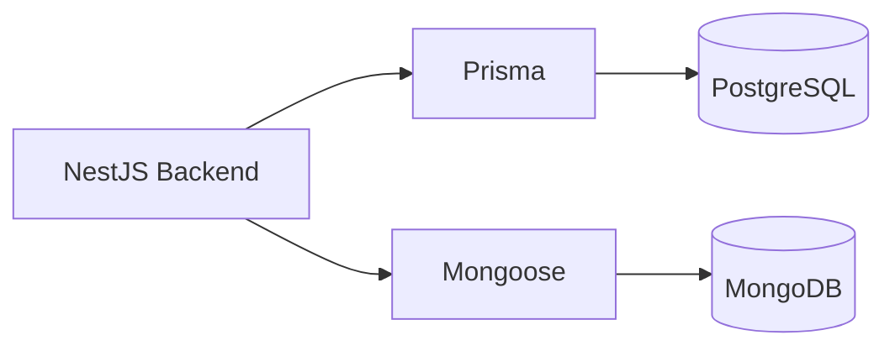
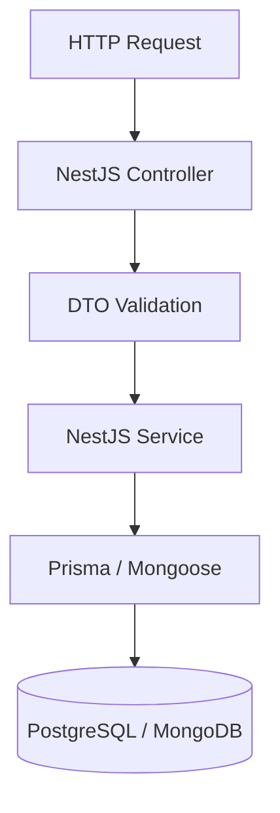
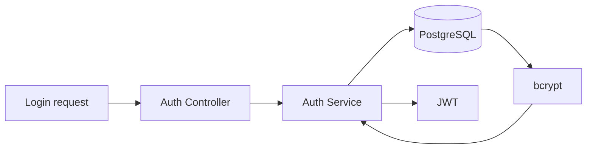

# Backend - Vrij lezen op maat

Deze map bevat de backend van de Proof of Concept **Vrij lezen op maat**.

De backend is gebouwd met **NestJS**, **TypeScript** en **Node.js** en vormt de centrale laag tussen de React-frontend en de gebruikte databases.

De backend is verantwoordelijk voor onder andere:

- authenticatie en autorisatie;
- leesprofielen;
- persoonlijke leesadviezen;
- toegang tot de boekcatalogus;
- leeslijsten;
- docent-studentkoppelingen;
- databasecommunicatie;
- validatie van inkomende gegevens;
- REST API-endpoints.

Voor relationele gegevens wordt **PostgreSQL** gebruikt via **Prisma**. De boekcatalogus wordt opgeslagen in **MongoDB** en benaderd via **Mongoose**.

---

## Technologieën

| Technologie | Gebruik |
|---|---|
| NestJS | Backendframework en modulaire applicatiestructuur |
| TypeScript | Typeveilig ontwikkelen |
| Node.js | Runtime voor de backend |
| PostgreSQL | Relationele opslag van gebruikers- en applicatiegegevens |
| Prisma | ORM voor PostgreSQL |
| MongoDB | Documentdatabase voor de boekcatalogus |
| Mongoose | ODM voor MongoDB |
| JWT | Authenticatie via access tokens |
| bcrypt | Hashen en controleren van wachtwoorden |
| class-validator | Validatie van DTO's |
| OpenAPI / Swagger | Beschrijving en documentatie van de REST API |
| Jest | Unit- en E2E-tests |
| Oxlint | Statische codecontrole |

---

## Vereisten

Voor het lokaal draaien van de backend zijn minimaal nodig:

- Node.js
- npm
- Docker Desktop
- PostgreSQL
- MongoDB

Binnen dit project worden de benodigde databases lokaal gestart via Docker.

---

## Installatie

Ga vanuit de root van het project naar de backendmap:

```bash
cd backend
```

Installeer vervolgens de dependencies:

```bash
npm install
```

---

## Environment variables

De backend gebruikt environment variables voor databaseverbindingen, authenticatie en vooraf aangemaakte testaccounts.

Maak in de map `backend/` een `.env`-bestand aan.

De gebruikte variabelen zijn onder andere:

```env
DATABASE_URL=
MONGODB_URI=
JWT_SECRET=

POSTGRES_USER=
POSTGRES_PASSWORD=
POSTGRES_DB=

MONGODB_USERNAME=
MONGODB_PASSWORD=

SEED_STUDENT_PASSWORD=
SEED_TEACHER_PASSWORD=
```

### `DATABASE_URL`

Bevat de verbindingsstring waarmee Prisma verbinding maakt met PostgreSQL.

### `MONGODB_URI`

Bevat de verbindingsstring waarmee Mongoose verbinding maakt met MongoDB.

### `JWT_SECRET`

Wordt gebruikt voor het ondertekenen en controleren van JWT access tokens.

### Seed-wachtwoorden

Omdat registratie geen functionele eis is binnen deze Proof of Concept worden student- en docentaccounts vooraf aangemaakt.

De wachtwoorden worden niet als platte tekst opgeslagen. Tijdens het aanmaken worden deze met bcrypt gehasht.

De `.env`-bestanden bevatten lokale configuratie en gevoelige gegevens en worden daarom niet opgenomen in Git.

---

## Databases starten

Start vanuit de locatie van het Docker Compose-bestand de benodigde containers:

```bash
docker compose up -d
```

Controleer vervolgens of de containers actief zijn:

```bash
docker compose ps
```

De backend gebruikt twee verschillende vormen van opslag:



### PostgreSQL

PostgreSQL bevat relationele gegevens zoals:

- gebruikers;
- leesprofielen;
- antwoorden op profielvragen;
- profielthema's;
- profielgenres;
- leeslijstitems;
- docent-studentkoppelingen.

### MongoDB

MongoDB bevat de boekcatalogus.

Boeken worden niet opnieuw als relationele `Book`-records in PostgreSQL opgeslagen.

Een leeslijstitem bevat daarom een `bookId` waarmee logisch naar een boek in MongoDB wordt verwezen.

Er bestaat tussen PostgreSQL en MongoDB geen database foreign key.

---

## Prisma

Prisma wordt gebruikt als ORM voor PostgreSQL.

Het Prisma-schema staat in:

```text
prisma/schema.prisma
```

Databasewijzigingen worden vastgelegd via Prisma-migraties.

Bestaande migraties bevinden zich in:

```text
prisma/migrations/
```

### Prisma Client genereren

Wanneer nodig kan de Prisma Client opnieuw worden gegenereerd met:

```bash
npx prisma generate
```

### Migraties toepassen

Om bestaande migraties op een lokale database toe te passen:

```bash
npx prisma migrate deploy
```

Tijdens development kan bij een bewuste wijziging van het Prisma-schema een nieuwe migratie worden aangemaakt met:

```bash
npx prisma migrate dev
```

Schemawijzigingen horen via migraties te worden uitgevoerd in plaats van rechtstreeks handmatig in PostgreSQL.

---

## Backend starten

Start de NestJS development server:

```bash
npm run start:dev
```

De backend is daarna standaard beschikbaar via:

```text
http://localhost:3000
```

Voor volledige functionaliteit moeten zowel PostgreSQL als MongoDB bereikbaar zijn.

---

## Projectstructuur

De backend is modulair opgebouwd. Iedere functionele module heeft zoveel mogelijk een eigen verantwoordelijkheid.

```text
backend/
├── src/
│   ├── auth/
│   │   ├── decorators/
│   │   │   └── public_decorator.ts
│   │   └── dto/
│   │
│   ├── books/
│   │   ├── dto/
│   │   ├── schemas/
│   │   └── types/
│   │
│   ├── generated/
│   │   ├── prisma/
│   │   ├── internal/
│   │   └── models/
│   │
│   ├── prisma/
│   │
│   ├── reading-list/
│   │   └── dto/
│   │
│   ├── reading-profile/
│   │   └── dto/
│   │
│   ├── recommendations/
│   │   └── types/
│   │
│   └── teacher-student-links/
│       └── dto/
│
├── prisma/
├── test/
└── README.md
```

---

## Backendmodules

### `auth/`

Bevat de authenticatie- en autorisatielogica van de backend.

De module is onder andere verantwoordelijk voor:

- inloggen;
- controleren van wachtwoorden met bcrypt;
- genereren van JWT access tokens;
- controleren van JWT-tokens;
- beschermen van endpoints;
- beschikbaar stellen van gebruikersgegevens uit het token.

#### `auth/decorators/`

Bevat custom NestJS decorators.

`public_decorator.ts` wordt gebruikt om endpoints expliciet als publiek toegankelijk te markeren.

Hierdoor kunnen bijvoorbeeld login-endpoints worden uitgesloten van de globale authenticatiecontrole.

#### `auth/dto/`

Bevat DTO's voor authenticatieverzoeken, zoals de gegevens die voor een login mogen worden aangeleverd.

DTO's zorgen ervoor dat inkomende data een vooraf gedefinieerde structuur heeft en kan worden gevalideerd.

---

### `books/`

Bevat de backendfunctionaliteit rondom de boekcatalogus in MongoDB.

Deze module is onder andere verantwoordelijk voor:

- ophalen van boeken;
- paginering;
- filtering;
- normaliseren van boekgegevens;
- ophalen van boekgegevens voor andere modules.

#### `books/dto/`

Bevat DTO's voor bijvoorbeeld queryparameters en filters van de catalogus.

#### `books/schemas/`

Bevat de Mongoose-schema's waarmee de structuur van MongoDB-documenten wordt beschreven.

#### `books/types/`

Bevat TypeScript-types die specifiek zijn voor de boekcatalogus.

---

### `generated/`

Bevat automatisch gegenereerde Prisma-code.

Deze map is opgesplitst in:

- `prisma/`;
- `internal/`;
- `models/`.

De bestanden in deze map worden door Prisma gegenereerd en horen niet handmatig aangepast te worden.

Bij wijzigingen aan `schema.prisma` wordt de gegenereerde code opnieuw opgebouwd via:

```bash
npx prisma generate
```

---

### `prisma/`

De map `src/prisma/` bevat de Prisma-integratie van de NestJS-applicatie.

De Prisma-service verzorgt de verbinding tussen de backendservices en PostgreSQL.

Hierdoor kunnen andere modules databasequeries uitvoeren via dezelfde geconfigureerde Prisma Client.

Dit moet niet worden verward met de map `backend/prisma/`.

- `src/prisma/` bevat de runtime-integratie met NestJS;
- `prisma/` bevat het databaseschema en de migraties.

---

### `reading-list/`

Bevat de businesslogica voor persoonlijke leeslijsten.

De module is onder andere verantwoordelijk voor:

- toevoegen van een boek aan een leeslijst;
- voorkomen van dubbele leeslijstitems;
- ophalen van de persoonlijke leeslijst;
- aanpassen van de gelezenstatus;
- controleren of een leeslijstitem bestaat.

#### `reading-list/dto/`

Bevat de DTO's die bepalen welke gegevens bij leeslijstrequests mogen worden aangeleverd.

---

### `reading-profile/`

Bevat de businesslogica voor het leesprofiel van een student.

De module is onder andere verantwoordelijk voor:

- ophalen van een bestaand leesprofiel;
- opslaan van een nieuw leesprofiel;
- wijzigen van een bestaand leesprofiel;
- opslaan van antwoorden;
- opslaan van voorkeuren zoals niveau, lengte en thema's.

De gegevens worden relationeel opgeslagen in PostgreSQL.

Waar meerdere gerelateerde gegevens tegelijkertijd gewijzigd moeten worden, wordt gebruikgemaakt van Prisma-transacties zodat de wijziging als één geheel kan worden uitgevoerd.

#### `reading-profile/dto/`

Bevat de DTO's voor leesprofielrequests.

Hiermee wordt onder andere gecontroleerd of verplichte gegevens aanwezig zijn en of aangeleverde waarden geldig zijn.

---

### `recommendations/`

Bevat de businesslogica waarmee persoonlijke leesadviezen worden samengesteld.

De aanbevelingen worden dynamisch berekend en worden niet als aparte records in PostgreSQL opgeslagen.

De module gebruikt:

- gegevens uit het leesprofiel;
- gegevens uit de MongoDB-boekcatalogus;
- vooraf bepaalde matchingcriteria en gewichten.

Onder andere wordt rekening gehouden met:

- leesniveau;
- thema of onderwerp;
- voorkeurslengte;
- materiaaltype.

Op basis van deze criteria krijgen boeken een score.

De best scorende boeken worden als persoonlijke aanbevelingen teruggegeven.

#### `recommendations/types/`

Bevat TypeScript-types die specifiek worden gebruikt binnen de aanbevelingslogica.

---

### `teacher-student-links/`

Bevat de businesslogica rondom de koppeling tussen docenten en studenten.

De module is onder andere verantwoordelijk voor:

- koppelen van een student aan een docent;
- ophalen van gekoppelde studenten;
- controleren of een docent aan een student gekoppeld is;
- ophalen van gegevens van een gekoppelde student;
- toevoegen van een boek aan de leeslijst van een gekoppelde student.

Deze module bevat belangrijke objectautorisatie.

Een docent mag alleen gegevens bekijken of wijzigen van studenten waaraan de docent daadwerkelijk gekoppeld is.

#### `teacher-student-links/dto/`

Bevat de DTO's voor requests rondom docent-studentkoppelingen.

---

## Backendarchitectuur

De backend gebruikt een gelaagde en modulaire NestJS-structuur.

De algemene flow is:



De belangrijkste verantwoordelijkheden zijn:

- **Controllers** verwerken HTTP-verzoeken en responses.
- **DTO's** beschrijven en valideren inkomende data.
- **Services** bevatten de businesslogica.
- **Prisma** verzorgt toegang tot PostgreSQL.
- **Mongoose** verzorgt toegang tot MongoDB.
- **Guards** controleren authenticatie en toegang.

Controllers bevatten zo weinig mogelijk businesslogica en delegeren deze naar services.

Hierdoor blijft de HTTP-laag gescheiden van de functionele logica.

---

## Architectuurkeuze

Er is gekozen voor een **gelaagde, modulaire architectuur** die aansluit bij de standaardopbouw van NestJS.

De scheiding is in hoofdlijnen:

```text
Controller
    ↓
Service
    ↓
Prisma / Mongoose
    ↓
Database
```

Voor deze Proof of Concept gebruiken services Prisma en Mongoose rechtstreeks.

Er is bewust geen extra repositorylaag toegevoegd. Een repositorylaag zou de businesslogica verder kunnen loskoppelen van de gekozen ORM of ODM, maar zou binnen de omvang van deze PoC ook extra abstractie en boilerplate toevoegen.

Voor een grotere productieapplicatie kan een aparte data-access- of repositorylaag nuttig zijn wanneer database-implementaties vaker moeten worden vervangen of wanneer de domeinlogica volledig onafhankelijk van de persistence-laag moet blijven.

---

## REST API

De frontend communiceert met de backend via een REST API.

De backend gebruikt voornamelijk:

- `GET` voor het ophalen van gegevens;
- `POST` voor het uitvoeren of toevoegen van acties;
- `PUT` voor het opslaan of wijzigen van gegevens.

Data wordt uitgewisseld als JSON.

Beveiligde endpoints verwachten een JWT Bearer-token:

```text
Authorization: Bearer <JWT>
```

De actuele endpoints en datastructuren zijn terug te vinden in de OpenAPI-documentatie.

---

## OpenAPI / Swagger

NestJS genereert een OpenAPI-specificatie voor de backend.

Wanneer de backend draait is Swagger beschikbaar via:

```text
http://localhost:3000/api-docs
```

Swagger toont onder andere:

- beschikbare endpoints;
- HTTP-methodes;
- requeststructuren;
- responsegegevens;
- beveiligde endpoints;
- JWT Bearer-authenticatie.

De frontendservices gebruiken dezelfde routes en datastructuren als de REST API.

OpenAPI vormt daarmee de gedocumenteerde API-overeenkomst tussen frontend en backend.

De frontendclient wordt binnen deze PoC niet automatisch uit de OpenAPI-specificatie gegenereerd. De implementatie wordt handmatig met het contract in overeenstemming gehouden.

---

## Authenticatie

Authenticatie verloopt via JWT.

Globaal verloopt de login als volgt:



Tijdens het inloggen:

1. wordt de gebruiker opgezocht in PostgreSQL;
2. wordt het ingevoerde wachtwoord met bcrypt gecontroleerd;
3. wordt bij geldige gegevens een JWT access token aangemaakt;
4. gebruikt de frontend dit token voor beveiligde requests.

Het wachtwoord zelf wordt niet als leesbare tekst opgeslagen.

---

## Autorisatie

Authenticatie bepaalt **wie** een gebruiker is.

Autorisatie bepaalt vervolgens **wat** deze gebruiker mag uitvoeren.

Binnen de backend wordt onder andere onderscheid gemaakt tussen:

- `STUDENT`;
- `TEACHER`.

Daarnaast wordt bij docentfunctionaliteit gecontroleerd of de docent daadwerkelijk gekoppeld is aan de betreffende student.

Hiermee wordt voorkomen dat een docent alleen door het aanpassen van een student-ID gegevens van een willekeurige student kan bekijken of wijzigen.

Deze controle wordt in de backend uitgevoerd en niet alleen in de frontend.

---

## DTO-validatie

Inkomende gegevens worden zoveel mogelijk via DTO's verwerkt.

DTO staat voor **Data Transfer Object**.

DTO's worden gebruikt om:

- de verwachte requeststructuur vast te leggen;
- verplichte velden af te dwingen;
- types te controleren;
- ongeldige waarden tegen te houden;
- controller- en servicelogica duidelijker te houden.

Validatie vindt plaats voordat businesslogica wordt uitgevoerd.

---

## Wachtwoordbeveiliging met bcrypt

Wachtwoorden worden gehasht met bcrypt voordat deze in PostgreSQL worden opgeslagen.

Hierdoor staat het daadwerkelijke wachtwoord niet in de database.

Bij een login gebruikt bcrypt de opgeslagen hash om te controleren of het ingevoerde wachtwoord overeenkomt.

bcrypt gebruikt onder andere een salt en is bewust relatief langzaam ontworpen. Hierdoor is het beter bestand tegen brute-force- en rainbow-table-aanvallen dan het opslaan van een gewone snelle hash.

Omdat registratie niet binnen de functionele requirements van deze Proof of Concept valt, worden de benodigde gebruikers vooraf aangemaakt.

---

## Testen

De backend gebruikt **Jest** voor geautomatiseerde tests.

### Unit tests

Voer vanuit `backend/` uit:

```bash
npm test
```

De unit tests richten zich vooral op businesslogica en relevante foutgevallen.

Onder andere worden onderdelen getest van:

- leesprofielen;
- aanbevelingen;
- leeslijsten;
- docent-studentkoppelingen.

Voorbeelden van gecontroleerde situaties zijn:

- correct opslaan van een leesprofiel;
- fout wanneer een profiel niet bestaat;
- scoreberekening van aanbevelingen;
- fallback bij onvoldoende passende aanbevelingen;
- voorkomen van dubbele leeslijstitems;
- aanpassen van gelezenstatus;
- weigeren van toegang tot een niet-gekoppelde student.

---

## E2E-tests

De belangrijkste geïntegreerde gebruikersflows worden gecontroleerd met E2E-tests.

Voer vanuit `backend/` uit:

```bash
npm run test:e2e
```

Binnen het project zijn bewust een beperkt aantal representatieve en risicovolle flows end-to-end getest.

### Studentenflow

De studentenflow controleert onder andere:

```text
Login
  ↓
JWT-authenticatie
  ↓
Leesprofiel
  ↓
Persoonlijke aanbevelingen
```

Hiermee wordt een centrale gebruikersflow van de applicatie over meerdere lagen tegelijk gecontroleerd.

### Docentenflow

De docentenflow richt zich vooral op autorisatie.

Onder andere wordt gecontroleerd dat:

- een docent toegang krijgt tot een gekoppelde student;
- een docent geen toegang krijgt tot een niet-gekoppelde student.

Deze flow is gekozen omdat ongeautoriseerde toegang tot gegevens van andere studenten een groter beveiligingsrisico vormt.

---

## E2E environment variables

Voor de E2E-tests wordt een apart bestand gebruikt:

```text
backend/.env.test
```

Hierin worden de testgegevens opgenomen:

```env
E2E_STUDENT_EMAIL=
E2E_STUDENT_PASSWORD=

E2E_TEACHER_EMAIL=
E2E_TEACHER_PASSWORD=

E2E_LINKED_STUDENT_ID=
E2E_UNLINKED_STUDENT_ID=
```

Hierdoor worden de testaccountgegevens gescheiden gehouden van de normale databaseconfiguratie.

Het `.env.test`-bestand wordt niet gecommit naar Git.

---

## Teststrategie

De teststrategie is gebaseerd op **risico en functioneel belang**.

Niet iedere methode of endpoint wordt afzonderlijk met dezelfde diepgang getest.

Er is gekozen voor:

- unit tests voor belangrijke businessregels;
- unit tests voor relevante fout- en randgevallen;
- E2E-tests voor belangrijke geïntegreerde gebruikersflows;
- extra aandacht voor autorisatie bij docentfunctionaliteit.

Hiermee wordt de belangrijkste logica afgedekt zonder een onnodig grote hoeveelheid tests voor deze Proof of Concept te schrijven.

---

## Linting

Voor statische codecontrole wordt **Oxlint** gebruikt.

Voer vanuit `backend/` uit:

```bash
npm run lint
```

De lintconfiguratie controleert de broncode en tests.

Binnen het project wordt onder andere type-aware linting gebruikt om mogelijke fouten en codekwaliteitsproblemen vroeg te signaleren.

Voor het afronden van het project hoort deze opdracht zonder fouten uitgevoerd te kunnen worden.

---

## Coding style guide

Voor de backend worden de gangbare conventies van **TypeScript en NestJS** gevolgd, aangevuld met projectspecifieke afspraken.

De belangrijkste afspraken zijn:

- classes, types en DTO's gebruiken PascalCase;
- functies en variabelen gebruiken camelCase;
- TypeScript wordt gebruikt voor typeveiligheid;
- modules worden per functioneel domein gegroepeerd;
- controllers verwerken HTTP-verkeer;
- businesslogica wordt zoveel mogelijk in services geplaatst;
- inkomende data wordt via DTO's beschreven en gevalideerd;
- databasecommunicatie verloopt via Prisma of Mongoose;
- gegenereerde code in `generated/` wordt niet handmatig aangepast;
- korte Engelse comments worden gebruikt wanneer verantwoordelijkheden of niet-vanzelfsprekende logica uitleg nodig hebben.

Deze afspraken zijn terug te zien in de mapstructuur en de implementatie van de backend.

Oxlint controleert daarnaast automatisch een deel van de codekwaliteit.

---

## Generated code

De map:

```text
src/generated/
```

bevat door Prisma gegenereerde code.

Deze bestanden worden niet handmatig onderhouden.

Wanneer het Prisma-schema verandert, wordt de client opnieuw gegenereerd met:

```bash
npx prisma generate
```

Wijzigingen horen daarom in het Prisma-schema en de eigen applicatiecode te worden uitgevoerd en niet rechtstreeks in gegenereerde bestanden.

---

## Foutafhandeling

De backend gebruikt HTTP-exceptions om fouten op een consistente manier naar de frontend terug te sturen.

Voorbeelden zijn:

- `NotFoundException` wanneer een resource niet bestaat;
- `ForbiddenException` wanneer een gebruiker onvoldoende rechten heeft;
- `ConflictException` wanneer bijvoorbeeld een dubbel leeslijstitem wordt toegevoegd;
- authenticatiefouten wanneer een JWT ontbreekt of ongeldig is.

Hierdoor kan de frontend onderscheid maken tussen verschillende foutscenario's en passende feedback aan de gebruiker tonen.

---

## Gerelateerde documentatie

Meer informatie over het volledige project staat in:

[Root README](../README.md)

Informatie over de React-frontend staat in:

[Frontend README](../frontend/README.md)

Aanvullende architectuur staat in:

[Architectuur](../.docs/architecture.md)

De aanpak voor de tests staat in:

[Teststrategie](../.docs/teststrategy.md)

De actuele REST API-documentatie is na het starten van de backend beschikbaar via:

```text
http://localhost:3000/api-docs
```