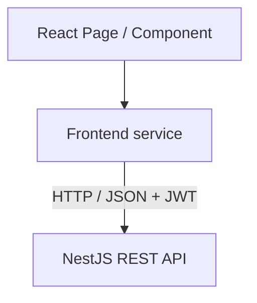
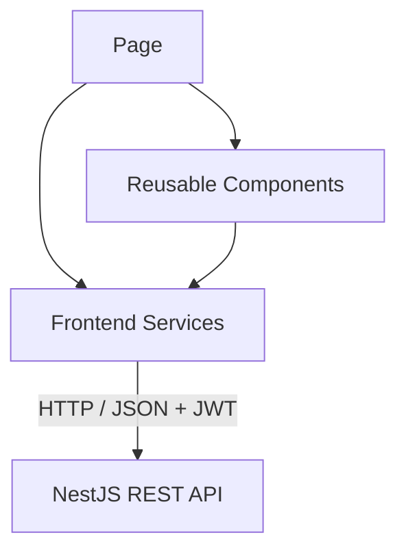
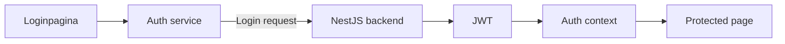

# Frontend - Vrij lezen op maat

Deze map bevat de frontend van de Proof of Concept **Vrij lezen op maat**.

De frontend is gebouwd met **React**, **TypeScript** en **Vite**. De applicatie bevat functionaliteit voor zowel studenten als docenten en communiceert via HTTP/JSON met de NestJS-backend.

De frontend heeft geen directe toegang tot PostgreSQL of MongoDB. Alle gegevens worden opgehaald en gewijzigd via de REST API van de backend.

---

## Technologieën

| Technologie | Gebruik |
|---|---|
| React | Opbouwen van de gebruikersinterface |
| TypeScript | Typeveilig ontwikkelen |
| Vite | Development server en build tooling |
| React Router | Navigatie en routing |
| Vitest | Geautomatiseerde frontendtests |
| ESLint | Statische codecontrole |
| CSS | Styling en responsive ontwerp |

---

## Vereisten

Voor het lokaal draaien van de frontend zijn minimaal nodig:

- Node.js
- npm
- een draaiende backend van Vrij lezen op maat

De backend draait standaard op:

```text
http://localhost:3000
```

---

## Installatie

Ga vanuit de root van het project naar de frontendmap:

```bash
cd frontend
```

Installeer vervolgens de dependencies:

```bash
npm install
```

---

## Frontend starten

Start de Vite development server:

```bash
npm run dev
```

De frontend is daarna standaard beschikbaar via:

```text
http://localhost:5173
```

Voor volledige functionaliteit moet de backend ook actief zijn.

---

## Projectstructuur

De frontend is verdeeld in mappen met ieder een eigen verantwoordelijkheid.

```text
frontend/
├── src/
│   ├── components/
│   │   ├── books/
│   │   ├── dashboard/
│   │   ├── home/
│   │   ├── layout/
│   │   └── ui/
│   ├── config/
│   ├── context/
│   ├── layouts/
│   ├── pages/
│   │   └── css/
│   ├── routes/
│   ├── services/
│   ├── test/
│   └── types/
└── README.md
```

### `components/`

Bevat herbruikbare React-componenten die op meerdere pagina's kunnen worden gebruikt.

De componenten zijn verder gegroepeerd op verantwoordelijkheid:

- `books/` bevat componenten voor het weergeven en gebruiken van boekgegevens.
- `dashboard/` bevat componenten die gebruikt worden op dashboardpagina's.
- `home/` bevat componenten die specifiek gebruikt worden op de homepagina's.
- `layout/` bevat componenten voor de algemene paginaopbouw, zoals navigatie- en headeronderdelen.
- `ui/` bevat algemene herbruikbare UI-componenten, zoals knoppen en andere interface-elementen.

Door herbruikbare onderdelen in `components/` te plaatsen wordt duplicatie tussen pagina's beperkt.

### `config/`

Bevat centrale frontendconfiguratie en vaste configuratiewaarden die door meerdere onderdelen van de applicatie worden gebruikt.

Hierdoor hoeven configuratiewaarden niet op meerdere plaatsen in de code te worden herhaald.

### `context/`

Bevat gedeelde applicatiestatus die beschikbaar moet zijn voor meerdere componenten en pagina's.

Binnen deze map wordt onder andere de authenticatiestatus van de gebruiker beheerd.

De authenticatiecontext houdt onder andere bij:

- welke gebruiker is ingelogd;
- welke rol de gebruiker heeft;
- of een gebruiker is ingelogd;
- het JWT access token;
- login en logout.

De authenticatielogica is opgesplitst over meerdere bestanden om verantwoordelijkheden te scheiden en problemen met React Fast Refresh te voorkomen.

### `layouts/`

Bevat gedeelde layouts voor pagina's.

Een layout bepaalt de algemene structuur rondom pagina-inhoud, bijvoorbeeld de header, navigatie en het gedeelte waarin de actieve pagina wordt weergegeven.

Hierdoor hoeft dezelfde algemene paginaopbouw niet op iedere pagina opnieuw te worden geïmplementeerd.

### `pages/`

Bevat de pagina-componenten van de applicatie.

Pagina's combineren herbruikbare componenten, state en services om een volledige gebruikerspagina te vormen.

Voorbeelden van functionaliteit die via pagina's beschikbaar is:

- inloggen;
- ingelogde homepagina;
- leesprofiel invullen;
- leesprofiel bekijken en wijzigen;
- persoonlijke leesadviezen bekijken;
- catalogus bekijken en filteren;
- leeslijst beheren;
- gekoppelde studenten bekijken als docent;
- gegevens en leeslijst van een gekoppelde student bekijken.

### `pages/css/`

Bevat styling die specifiek hoort bij de verschillende pagina's.

Pagina-specifieke CSS wordt hier gescheiden gehouden van algemene component- en layoutstyling.

### `routes/`

Bevat de routerconfiguratie van de applicatie.

Hier wordt onder andere bepaald:

- welke URL bij welke pagina hoort;
- welke pagina's alleen toegankelijk zijn voor ingelogde gebruikers;
- welke pagina's bedoeld zijn voor studenten;
- welke pagina's bedoeld zijn voor docenten.

De frontend gebruikt routebescherming voor de gebruikerservaring en navigatie. De daadwerkelijke autorisatie wordt daarnaast altijd opnieuw door de backend gecontroleerd.

### `services/`

Bevat de communicatie tussen de React-frontend en de NestJS-backend.

API-verzoeken worden zoveel mogelijk gecentraliseerd in servicebestanden in plaats van rechtstreeks vanuit pagina's te worden uitgevoerd.

De algemene communicatiestroom is:



Services zijn onder andere verantwoordelijk voor:

- het ophalen van gegevens;
- het versturen van gegevens;
- het wijzigen van bestaande gegevens;
- het meesturen van het JWT-token bij beveiligde requests;
- het verwerken van API-responses.

Deze opzet zorgt ervoor dat pagina's zich voornamelijk kunnen richten op presentatie en gebruikersinteractie.

### `test/`

Bevat configuratie en ondersteuning voor de geautomatiseerde frontendtests.

Voor frontendtests wordt **Vitest** gebruikt.

### `types/`

Bevat gedeelde TypeScript-types en interfaces.

Hierdoor kunnen dezelfde datastructuren op meerdere plaatsen binnen de frontend worden gebruikt en kan TypeScript tijdens development controleren of gegevens op de verwachte manier worden verwerkt.

---

## Frontendarchitectuur

De frontend gebruikt een eenvoudige gelaagde en componentgebaseerde opbouw.



De belangrijkste verantwoordelijkheden zijn:

- **Pages** vormen volledige schermen en sturen gebruikersinteractie aan.
- **Components** bevatten herbruikbare UI-elementen.
- **Context** beheert gedeelde applicatiestatus.
- **Services** verzorgen communicatie met de backend.
- **Types** beschrijven gedeelde datastructuren.

Er is bewust voor gekozen om API-calls zoveel mogelijk in `services/` te centraliseren. Hierdoor blijft communicatie met de backend gescheiden van de presentatielaag.

---

## Authenticatie

De frontend gebruikt JWT-authenticatie.

Na een succesvolle login ontvangt de frontend een access token van de backend. De authenticatiecontext beheert vervolgens de ingelogde gebruiker en het token.

Globaal verloopt dit als volgt:



De loginstatus wordt lokaal bewaard zodat een gebruiker na het verversen van de browser niet direct opnieuw hoeft in te loggen.

Daarnaast wordt gecontroleerd of het opgeslagen JWT-token verlopen is.

### Routebescherming

De frontend gebruikt routes en authenticatiestatus om gebruikers alleen de pagina's te tonen die bij hun rol horen.

Deze frontendcontrole is echter geen vervanging voor backendbeveiliging.

De daadwerkelijke authenticatie en autorisatie wordt altijd door de NestJS-backend uitgevoerd. Hierdoor kan een gebruiker niet alleen door het manipuleren van frontendroutes toegang krijgen tot beveiligde gegevens.

---

## API-communicatie

De frontend communiceert met de backend via een REST API.

Daarbij worden voornamelijk de volgende HTTP-methodes gebruikt:

- `GET` voor het ophalen van gegevens;
- `POST` voor het toevoegen van gegevens of uitvoeren van acties;
- `PUT` voor het wijzigen of opslaan van gegevens.

De gegevens worden uitgewisseld als JSON.

Voor beveiligde endpoints wordt het JWT-token meegestuurd als Bearer-token:

```text
Authorization: Bearer <JWT>
```

De API wordt aan de backendkant beschreven met OpenAPI/Swagger.

Wanneer de backend lokaal draait is de API-documentatie beschikbaar via:

```text
http://localhost:3000/api-docs
```

---

## State management

Voor gedeelde authenticatiestatus wordt gebruikgemaakt van React Context.

Niet alle state wordt globaal opgeslagen. Pagina- of componentgebonden state blijft zoveel mogelijk lokaal bij het onderdeel dat deze nodig heeft.

Hierdoor wordt voorkomen dat onnodig veel applicatiestatus centraal beheerd moet worden.

Voor het leesprofiel wordt tijdelijke invoer tijdens het doorlopen van het formulier bewaard zodat de gebruiker binnen de flow niet direct zijn ingevoerde gegevens verliest.

---

## Styling

De applicatie gebruikt CSS voor de visuele vormgeving.

De styling is verdeeld over algemene styling, componentstyling en pagina-specifieke styling.

Belangrijke uitgangspunten zijn:

- consistente vormgeving tussen pagina's;
- herbruikbare UI-componenten;
- duidelijke interactieve elementen;
- ondersteuning voor desktop en mobiel;
- behoud van functionaliteit op kleinere schermen.

---

## Responsive design

De frontend is ontworpen voor zowel desktop- als mobiele schermen.

Op kleinere schermen wordt onder andere de navigatie aangepast zodat de beschikbare ruimte beter wordt gebruikt.

Bij de responsive uitwerking is gecontroleerd dat belangrijke functionaliteit beschikbaar blijft, waaronder:

- navigatie;
- inloggen en uitloggen;
- leesprofiel;
- leesadviezen;
- catalogus;
- leeslijst;
- docentfunctionaliteit.

---

## Accessibility

Bij de frontend is rekening gehouden met basisprincipes uit **WCAG 2.1 niveau A**.

Onder andere is aandacht besteed aan:

- semantische HTML;
- labels bij formulierinvoer;
- toetsenbordnavigatie;
- zichtbare focusstatus;
- voldoende contrast;
- duidelijke foutmeldingen;
- relevante ARIA-attributen waar native HTML onvoldoende informatie geeft.

ARIA wordt alleen toegevoegd wanneer dit aanvullende betekenis heeft. Waar mogelijk worden standaard semantische HTML-elementen gebruikt.

Voorbeelden van toegepaste accessibility-technieken zijn:

- `role="alert"` voor relevante foutmeldingen;
- `role="status"` voor statusinformatie;
- `aria-busy` tijdens het laden van gegevens;
- `aria-hidden` voor puur decoratieve elementen.

---

## Loading en foutafhandeling

Pagina's die gegevens uit de backend ophalen houden rekening met verschillende toestanden:

- gegevens worden geladen;
- gegevens zijn succesvol opgehaald;
- er is geen data beschikbaar;
- een request is mislukt.

Hierdoor krijgt de gebruiker niet alleen een leeg scherm wanneer gegevens nog worden opgehaald of wanneer een API-request mislukt.

Waar nodig wordt een laadindicatie of skeleton loading gebruikt.

---

## Testen

Voor geautomatiseerde frontendtests wordt **Vitest** gebruikt.

Voer de tests vanuit de map `frontend/` uit:

```bash
npm test
```

De frontendtests richten zich op relevante component- en gebruikersinterfacefunctionaliteit.

De belangrijkste geïntegreerde gebruikersflows worden daarnaast gecontroleerd met E2E-tests in de backend-testomgeving.

---

## Linting

Voor statische codecontrole wordt **ESLint** gebruikt.

Voer vanuit `frontend/` uit:

```bash
npm run lint
```

ESLint controleert onder andere:

- algemene codekwaliteit;
- React-gerelateerde regels;
- React Hooks-regels;
- mogelijke programmeerfouten.

Voor het afronden van het project hoort deze opdracht zonder fouten uitgevoerd te kunnen worden.

---

## Coding style guide

Voor de frontend worden de gangbare conventies van **TypeScript en React** gevolgd, aangevuld met projectspecifieke afspraken.

De belangrijkste afspraken zijn:

- React-componenten gebruiken PascalCase.
- Functies en variabelen gebruiken camelCase.
- TypeScript wordt gebruikt voor typeveiligheid.
- Componenten hebben zoveel mogelijk één duidelijke verantwoordelijkheid.
- Herbruikbare componenten worden geplaatst in `src/components/`.
- Volledige pagina's worden geplaatst in `src/pages/`.
- API-communicatie wordt gecentraliseerd in `src/services/`.
- Globale authenticatiestatus wordt beheerd via `src/context/`.
- Pagina-specifieke styling wordt gescheiden gehouden van componentlogica.
- Korte Engelse comments worden gebruikt bij bestanden en niet-vanzelfsprekende logica.

Deze afspraken zijn doorgevoerd in de projectstructuur en de codebase.

ESLint wordt gebruikt om een deel van deze afspraken automatisch te controleren. Andere afspraken, zoals de verantwoordelijkheidsverdeling tussen pages, components en services, worden door de gekozen projectstructuur toegepast.

---

## Build

Om een productie-build van de frontend te maken:

```bash
npm run build
```

Vite maakt vervolgens een geoptimaliseerde build aan.

Binnen deze Proof of Concept is alleen lokaal draaien en testen ingericht. Externe hosting valt buiten de gerealiseerde scope.

---

## Gerelateerde documentatie

Meer informatie over het volledige project staat in:

[Root README](../README.md)

Informatie over de backend, databases, API, Prisma en authenticatie staat in:

[Backend README](../backend/README.md)

Aanvullende architectuur staat in:

[Architectuur](../.docs/architecture.md)

De aanpak voor de tests staat in:

[Teststrategie](../.docs/teststrategy.md)